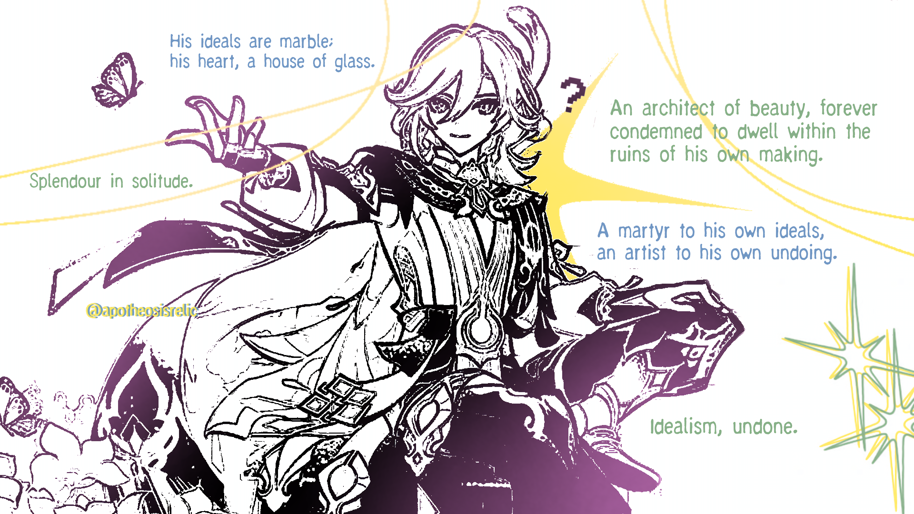
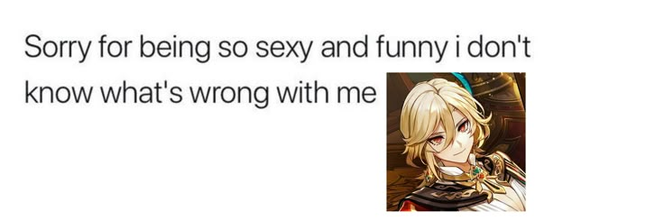

  

# ENZO
### SACRED ALTAR

*An archive of personal interests, creative pursuits and collected sentiments.*

VOL. 001 · PERSONAL EDITION

✦ ───────────────────── ✦

[ INTRODUCTION ](#i-personal-record) ·
[ SACRED ALTAR ](#ii-sacred-altar) ·
[ MUSIC ](#iii-musical-collection) ·
[ COPYRIGHT ](#iv-copyright--ownership)

---

## I. PERSONAL RECORD

### THE INDIVIDUAL BEHIND THE ALTAR

Greetings, I'm **Enzo**.

A student and graphic designer with an appreciation for visual storytelling, artistic compositions, literature and music.

I find interest in the details of creative expression, the beauty of visual arrangements and the individuality of things worth remembering.

| ARCHIVAL DETAILS | INFORMATION |
|:---|:---|
| Name | Sora |
| Alias | Enzo |
| Pronouns | He / She / any |
| Occupation | Student & Graphic Designer |
| Nationality | Chinese and a mix of korean |
| Favourite colours | Black · White · Red |
| Aesthetic | Vintage · Dark Academia · Editorial |
| Interests | Graphic design, literature, music and writing |
| Discord | `rotofdivinity` |

---

## II. SACRED ALTAR

*An assortment of personal interests, artistic inspirations and things that have earned a place in my collection.*

 

FIG. 001 — A VISUAL REPRESENTATION OF MY INTERESTS

### A. FAVOURITE SERIES

A collection of fictional worlds, narratives and characters I hold in high regard.

- **01.** Mo dao Zu Shi
- **02.** Attack On Titan
- **03.** Tian Guan Ci Fu

### B. PERSONAL INTERESTS

- Graphic design and visual compositions.
- Literature and creative writing.
- Artistic expression and aesthetics.
- Fictional characters and storytelling.

---

## III. MUSICAL COLLECTION

*Melodies that have found their way into my personal collection.*

| NO. | TITLE | ARTIST |
|:---:|:---|:---|
| 001 | Unethical | Faouzia |
| 002 | Line Without a Hook | ricky montgomery |
| 003 | He's my man | luvcat |
| 004 | I wanna be Yours | Arctic Monkeys |
| 005 | Sweather Weather | The Neighbourhood |

---

## IV. COPYRIGHT & OWNERSHIP

### ARTIST'S NOTICE — ALL RIGHTS RESERVED.

I am a **graphic designer**. All original graphic designs, edits, visual compositions and creative works displayed or published by me belong to me unless otherwise credited.

**UNAUTHORIZED USE IS STRICTLY PROHIBITED.**

- No reposting or redistributing my works.
- No editing, modifying or reproducing my creations.
- No copying, tracing or claiming my works as your own.
- No using my designs for personal or commercial purposes without permission.
- No taking my works for inspiration or reference without consent.

Please respect the time, effort and creativity invested in every creation.

**No permission means no usage.**

✦ ───────────────────── ✦

### THANK YOU FOR VISITING.

*An archive of things created, appreciated and remembered.*

**ENZO — SACRED ALTAR**

© All rights reserved.

